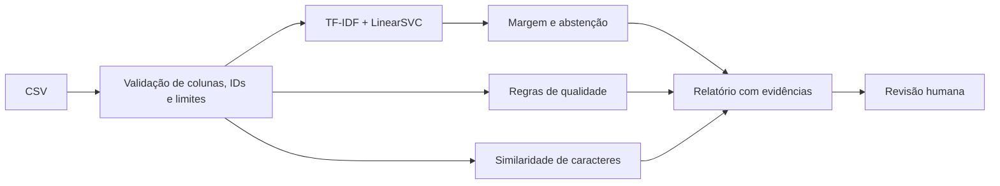
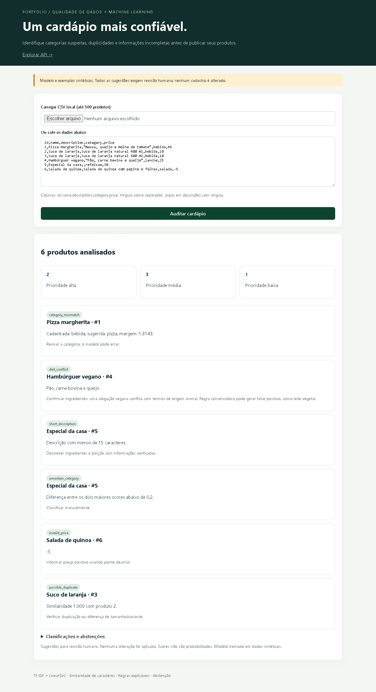

# Auditor de Cardápios com IA

[](https://github.com/Vzorzettoo/auditor-cardapios-ia/actions/workflows/ci.yml)


> Projeto independente de portfólio com dados sintéticos. Não é produto oficial do iFood e não possui integração com pedidos ou dados da empresa.

Auditoria de cardápios em CSV para identificar categorias suspeitas, duplicidades, preços inválidos, descrições curtas e possíveis contradições alimentares. Todas as saídas são sugestões para **revisão humana**; nenhum cadastro é alterado.

**Exemplo:** uma pizza cadastrada como bebida recebe uma sugestão de categoria; duas linhas semelhantes são sinalizadas para verificar se são duplicatas ou variantes legítimas.

### Arquitetura



### API e formato dos dados

`POST /api/audit` recebe `{"csv_text":"id,name,description,category,price\n..."}`. `GET /api/sample` fornece o CSV de demonstração.

```csv
id,name,description,category,price
1,Pizza margherita,"Massa, queijo e molho de tomate",bebida,45
2,Suco de laranja,Suco de laranja natural 400 ml,bebida,10
```

- Separador: vírgula. Preço usa ponto decimal; descrições contendo vírgulas precisam de aspas.
- Até 500 produtos, 500 mil caracteres no conteúdo e 2000 caracteres por campo.
- IDs preenchidos e únicos. Categorias: `pizza`, `bebida`, `sobremesa`, `lanche`, `refeicao`, `salada`.
- Preços inválidos e categorias inválidas viram alertas. Problemas estruturais de CSV retornam 422.

### Modelo e avaliação

72 exemplos sintéticos autorais em `data/labeled.json`, com separação explícita de **48 treino e 24 teste**, sem textos idênticos entre os conjuntos. O treinamento ocorre no início da aplicação. TF-IDF é ajustado **somente no treino**. O relatório compara MultinomialNB e LinearSVC por macro-F1 e métricas por classe.

O LinearSVC se abstém quando a diferença entre os dois maiores scores é menor que 0,2. Esse limiar é uma escolha demonstrativa, não calibrada; a margem **não é probabilidade**. O relatório mostra cobertura e acurácia apenas nos exemplos cobertos.

`python -m app.evaluate` reproduz `reports/evaluation.json`.

### Limitações

O conjunto é pequeno, balanceado e compartilha vocabulário entre treino e teste; desempenho alto nele não comprova generalização em cardápios reais. Regras alimentares são conservadoras e podem sinalizar falsos positivos como "leite vegetal". Similaridade textual não distingue automaticamente porções, marcas e sabores. Não é detector de alergênicos. Para uso real: ampliar anotações, separar estabelecimentos entre treino/teste, calibrar abstenção e medir a precisão de cada tipo de alerta em revisão humana.


## Interface



## Executar localmente

Requer Python 3.12 e acesso à internet apenas para instalar as dependências. Não exige chave de API paga.

```bash
git clone https://github.com/Vzorzettoo/auditor-cardapios-ia.git
cd auditor-cardapios-ia
python -m venv .venv
```

Ative o ambiente no **PowerShell**:

```powershell
.\.venv\Scripts\Activate.ps1
```

Ou no **Linux/macOS**:

```bash
source .venv/bin/activate
```

Depois:

```bash
python -m pip install -r requirements-dev.txt
python -m uvicorn app.main:app --host 127.0.0.1 --port 8002
```

Abra **http://127.0.0.1:8002** para a interface e **http://127.0.0.1:8002/docs** para a API interativa. Sem permissão para ativar scripts no PowerShell, use diretamente `.\.venv\Scripts\python.exe` no lugar de `python`, sem alterar políticas do Windows.

### Resultados registrados nesta execução

| Modelo | Macro-F1 |
|---|---:|
| naive_bayes | 0.8175 |
| linear_svc | 0.8657 |

Teste em 24 exemplos sintéticos. O vocabulário compartilhado torna o conjunto mais fácil que um cenário real.

## Testes e relatórios

```bash
python -m pytest -q
python -m app.evaluate
```

O relatório JSON é salvo em `reports/evaluation.json`. Os testes verificam regras de negócio, casos inválidos e comportamento da API. O workflow de CI executa testes e avaliação a cada push/PR.

## Docker

```bash
docker build -t auditor-cardapios-ia .
docker run --rm -p 127.0.0.1:8002:8000 auditor-cardapios-ia
```

Dockerfile fornecido; execução de contêiner não foi validada neste ambiente. A aplicação não tem autenticação nem controle de taxa e foi preparada para demonstração local. Antes de exposição pública, adicionar esses controles e limites de corpo na infraestrutura.

## Estrutura

```text
app/       API, modelos e avaliação
data/      exemplos sintéticos autorais
static/    interface web sem dependências externas
tests/     testes automatizados
reports/   avaliação reproduzível
docs/      decisões e roteiro de demonstração
```

## Autoria e transparência

Portfólio de **Vinicius Zorzetto**. Implementação inicial desenvolvida com assistência de IA. As métricas são obtidas pelo script de avaliação, não resultados comerciais. Não houve validação com estabelecimentos ou clientes reais. Dados e código sob licença MIT.

## Referências técnicas

- [FastAPI: testes de API](https://fastapi.tiangolo.com/tutorial/testing/)
- [Scikit-learn: TF-IDF](https://scikit-learn.org/stable/modules/generated/sklearn.feature_extraction.text.TfidfVectorizer.html)
- [Scikit-learn: validação temporal](https://scikit-learn.org/stable/modules/generated/sklearn.model_selection.TimeSeriesSplit.html)
